

  

<h1 align="center">Abdelmonaam Satouri</h1>

  <b>Développeur full-stack · Fondateur de Satouri Développement</b>
   
  Sites web, applications mobiles et SaaS sur mesure — depuis Djerba, pour la Tunisie et la France.

  
  
  

---

## À propos

Une bonne application change la manière dont les gens travaillent, achètent et gèrent leur quotidien. Je pars d'un besoin réel et je livre un produit simple, rapide et fiable : de l'interface à la logique métier et aux données, jusqu'à la mise en production.

- 🎓 **Master Pro Génie Logiciel** — ISIMM, Monastir (en cours)
- 🎓 **Licence en Informatique, mention Très Bien** — ISIMM, Monastir (2026)
- 🌍 Français · English · العربية
- 📍 Djerba, Tunisie — clients en Tunisie et en France

## Stack

**Front-end**

     

**Mobile**

  

**Back-end & données**

    

**IA & automatisation**

  

**Outils & déploiement**

   

## Réalisations

<table>
<tr>
<td width="50%" valign="top">
<a href="https://github.com/monaam216/4126-le-parfums-showcase">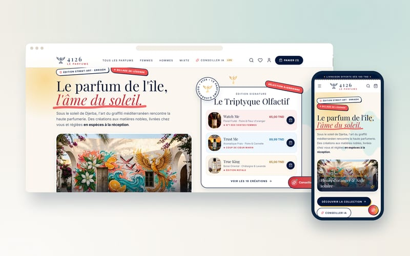</a>
<h3>4126 Le Parfums</h3>
Site web · 2026

Boutique en ligne de parfums de luxe, avec conseiller parfum par IA et back-office complet.

<a href="https://github.com/monaam216/4126-le-parfums-showcase">Vitrine</a> · <a href="https://4126-leparfums.vercel.app">Site</a> · <a href="https://satouri-dev.vercel.app/fr/projects/4126-le-parfums">Étude de cas</a>

</td>
<td width="50%" valign="top">
<a href="https://github.com/monaam216/meuble-jaafar-plus-showcase">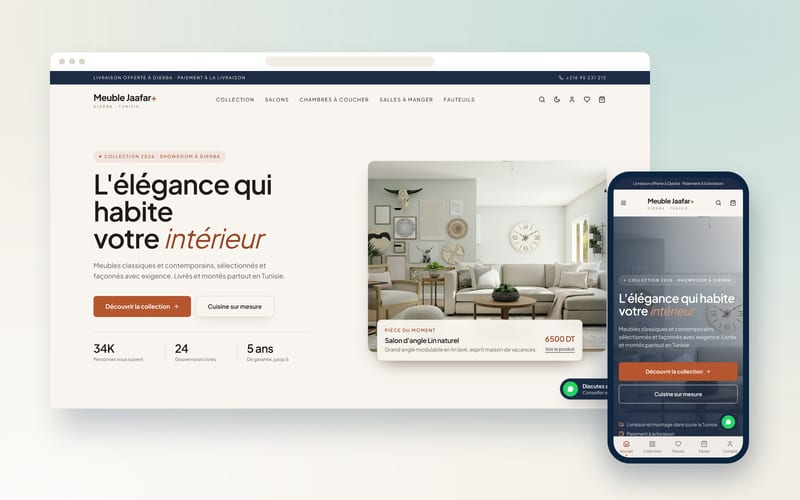</a>
<h3>Meuble Jaafar+</h3>
Site web · 2026

Boutique de meubles en ligne avec paiement à la livraison ou acompte, et back-office de facturation complet.

<a href="https://github.com/monaam216/meuble-jaafar-plus-showcase">Vitrine</a> · <a href="https://meuble-jaafer-plus.vercel.app">Site</a> · <a href="https://satouri-dev.vercel.app/fr/projects/meuble-jaafar-plus">Étude de cas</a>

</td>
</tr>
<tr>
<td width="50%" valign="top">
<a href="https://github.com/monaam216/jh-auto-location-showcase">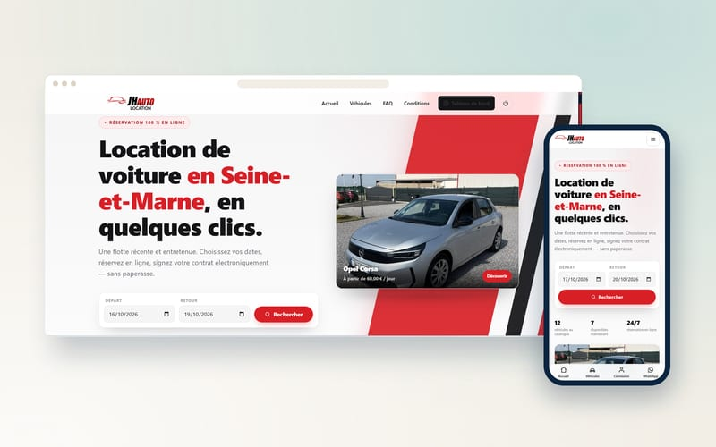</a>
<h3>JH AUTO LOCATION</h3>
Système sur mesure · 2025

Plateforme de location de voitures avec calendrier de réservations, contrats PDF et emails automatiques.

<a href="https://github.com/monaam216/jh-auto-location-showcase">Vitrine</a> · <a href="https://jhauto.fr">Site</a> · <a href="https://satouri-dev.vercel.app/fr/projects/jh-auto-location">Étude de cas</a>

</td>
<td width="50%" valign="top">
<a href="https://github.com/monaam216/comptatunisie-pro-showcase">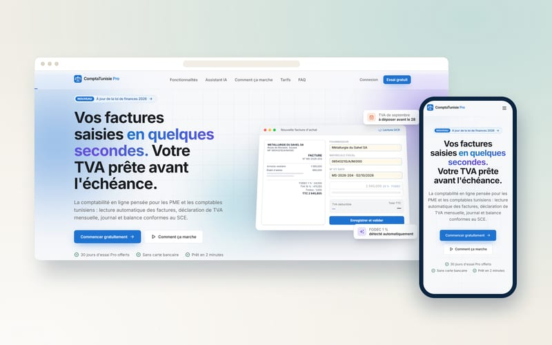</a>
<h3>ComptaTunisie Pro</h3>
Système sur mesure · 2026

SaaS de comptabilité pour PME et cabinets tunisiens : OCR des factures, TVA et déclarations.

<a href="https://github.com/monaam216/comptatunisie-pro-showcase">Vitrine</a> · <a href="https://compta-tunisie-pro.vercel.app">Site</a> · <a href="https://satouri-dev.vercel.app/fr/projects/comptatunisie-pro">Étude de cas</a>

</td>
</tr>
<tr>
<td width="50%" valign="top">
<a href="https://github.com/monaam216/dari-manager-showcase">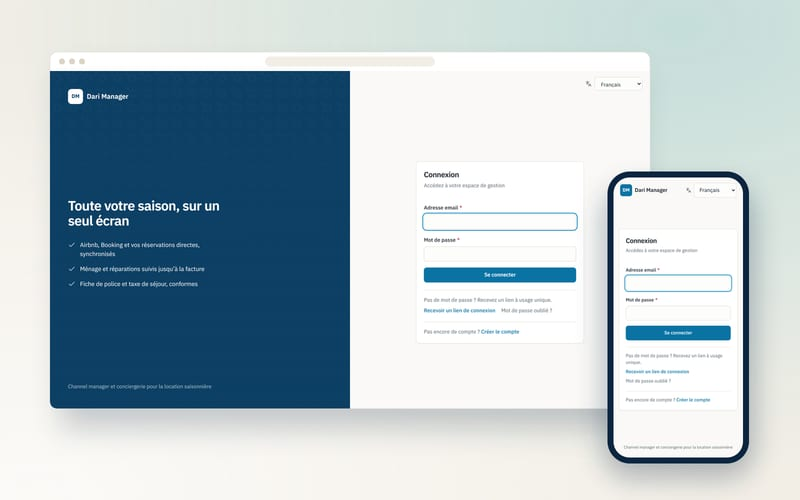</a>
<h3>Dari Manager</h3>
Système sur mesure · 2026

Channel manager et outil de conciergerie pour la location courte durée en Tunisie.

<a href="https://github.com/monaam216/dari-manager-showcase">Vitrine</a> · <a href="https://darimanager-web.vercel.app">Site</a> · <a href="https://satouri-dev.vercel.app/fr/projects/dari-manager">Étude de cas</a>

</td>
<td width="50%" valign="top">
<a href="https://github.com/monaam216/hakouti-motors-showcase">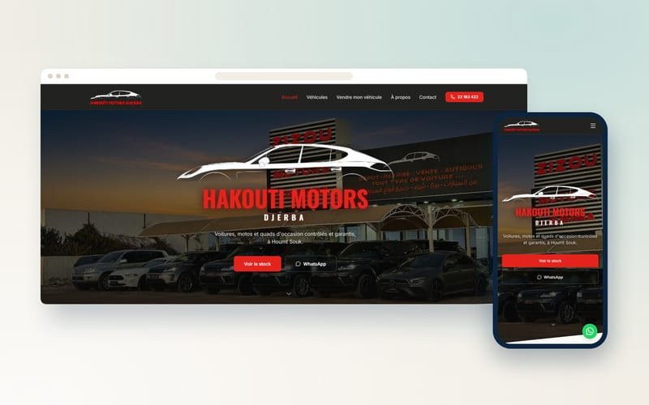</a>
<h3>Hakouti Motors Djerba</h3>
Site web · 2025

Site vitrine de concessionnaire automobile, alimenté automatiquement par le feed Instagram du client.

<a href="https://github.com/monaam216/hakouti-motors-showcase">Vitrine</a> · <a href="https://hakouti-motors-djerba.com">Site</a> · <a href="https://satouri-dev.vercel.app/fr/projects/hakouti-motors">Étude de cas</a>

</td>
</tr>
<tr>
<td width="50%" valign="top">
<a href="https://github.com/monaam216/sr-architecture-showcase">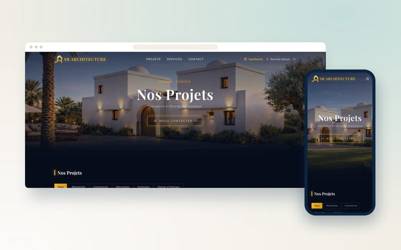</a>
<h3>SR Architecture Djerba</h3>
Site web · 2025

Site vitrine d'un cabinet d'architecture, travaillé au corps côté référencement.

<a href="https://github.com/monaam216/sr-architecture-showcase">Vitrine</a> · <a href="https://www.sr-architecture-djerba.com">Site</a> · <a href="https://satouri-dev.vercel.app/fr/projects/sr-architecture">Étude de cas</a>

</td>
<td width="50%" valign="top">
<a href="https://github.com/monaam216/jh-auto-atelier-showcase">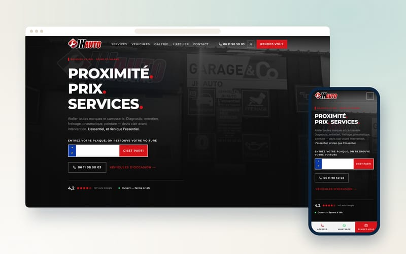</a>
<h3>JH Auto Atelier</h3>
Site web · 2026

Site et back-office d’un garage-carrosserie : rendez-vous en ligne, devis et vente de véhicules.

<a href="https://github.com/monaam216/jh-auto-atelier-showcase">Vitrine</a> · <a href="https://jhauto-atelier.vercel.app">Site</a> · <a href="https://satouri-dev.vercel.app/fr/projects/jh-auto-atelier">Étude de cas</a>

</td>
</tr>
<tr>
<td width="50%" valign="top">
<a href="https://github.com/monaam216/k-beauty-hair-salon-showcase">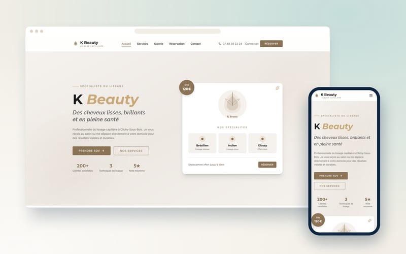</a>
<h3>K Beauty Hair Salon</h3>
Site web · 2026

Site de salon de coiffure avec réservation de créneaux en ligne et paiement sécurisé.

<a href="https://github.com/monaam216/k-beauty-hair-salon-showcase">Vitrine</a> · <a href="https://satouri-dev.vercel.app/fr/projects/k-beauty-hair-salon">Étude de cas</a>

</td>
<td width="50%" valign="top">
<a href="https://github.com/monaam216/el-majless-showcase">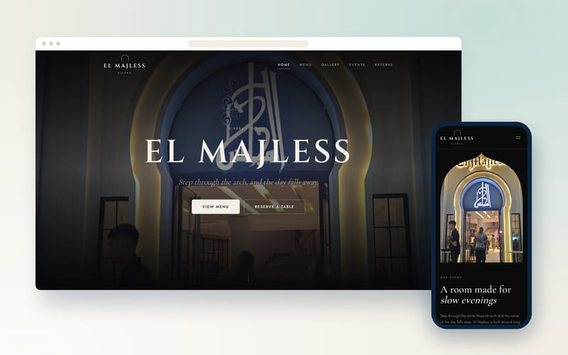</a>
<h3>El Majless</h3>
Système sur mesure · 2025

Commande au restaurant par QR code, avec panneau de cuisine mis à jour en temps réel.

<a href="https://github.com/monaam216/el-majless-showcase">Vitrine</a> · <a href="https://elmajless.vercel.app">Site</a> · <a href="https://satouri-dev.vercel.app/fr/projects/el-majless">Étude de cas</a>

</td>
</tr>
<tr>
<td width="50%" valign="top">
<a href="https://github.com/monaam216/tunisiebooking-showcase">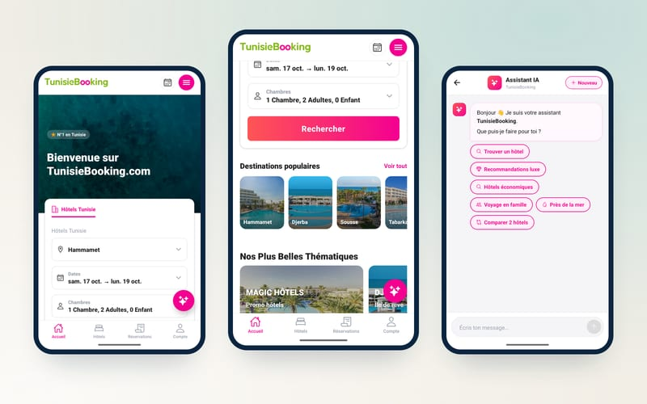</a>
<h3>TunisieBooking</h3>
Application mobile · 2026

Application mobile de réservation d'hôtels — 199 hôtels tunisiens, paiement Stripe et assistant IA.

<a href="https://github.com/monaam216/tunisiebooking-showcase">Vitrine</a> · <a href="https://satouri-dev.vercel.app/fr/projects/tunisiebooking">Étude de cas</a>

</td>
<td width="50%"></td>
</tr>
</table>

> [!NOTE]
> Les dépôts de code sont privés : ce sont des projets clients ou des produits. Chaque projet a un dépôt **vitrine** public avec sa présentation, ses fonctionnalités et des captures.

---

  Un projet en tête ? <a href="https://satouri-dev.vercel.app/fr#contact">Parlons-en</a> — réponse sous 24 h.

